La comunidad de WhatsApp se incorpora a la landing de venta como primer nivel, con Standard y VIP como productos principales. La nueva bandera `NEXT_PUBLIC_PARTE_LIVE` permite abrir la academia con la comunidad en Próximamente y habilitar su venta después mediante un nuevo build.

## Cambios
- Identidad y copy de comercio centralizados en `src/lib/content.ts`. Un solo literal para el nombre; logo reemplazable en `public/parte-logo.png`.
- Tres niveles, FAQ de diferencias, navegación y pie condicionales. `/parte` tiene compra visible sin scroll a 375 px y un estado diseñado de Próximamente sin precio ni checkout.
- Soporte por número incorrecto y entrega a una comunidad privada de WhatsApp en un máximo de 72 horas. Las invitaciones de gracias y lista de espera respetan las dos banderas.
- Tally conserva su flujo: solo se expone `submitted` tras su evento validado. La oferta de espera no aparece antes del envío ni en la maqueta.
- Advertencias de build por checkout ausente. Ambas gracias conservan `noindex, nofollow` y quedan fuera del sitemap.
- Pixel conserva su comportamiento y sigue vacío; solo el nombre del producto pasa a la constante. Sin GTM.

## Validación local
- `npm run build`, `npm run lint`, `npm test`: correctos, 15 pruebas.
- Cuatro builds: waitlist/off, waitlist/on, launch/off y launch/on. 96 comprobaciones en 8 rutas a 375, 768 y 1280 px: sin overflow ni errores de JavaScript; con off no existe checkout de comunidad en el HTML.
- Tally simulado: origen, ventana y formId incorrectos no activan la invitación. Sin formularios reales, compras ni solicitudes a Meta.
- Axe: 0 infracciones automatizadas en precios y las tres páginas de comercio, en los tres tamaños.
- Lighthouse móvil, una pasada por versión contra producción local: home 90 → 95; /parte 96 → 98. CLS 0. JS final 157.6 / 158.8 KiB. La home conserva LCP 2.86 s, por encima del objetivo anterior de 2.5 s (base: 3.54 s); no se cambió el hero. No son métricas del hosting productivo.

[Informe y evidencia completa](https://github.com/mgh-nextlevelugc/academiamerlo/blob/ab0efdf98921e5807fd23ca42d4e3047e992502a/docs/qa/unified-launch/README.md), con capturas adicionales a 768 px, estados Próximamente y confirmación de Tally.

## Variables que Migue debe cargar en Vercel antes de desplegar
Aplicar en Production y Preview. Las NEXT_PUBLIC se fijan al construir; cambiar un valor requiere nuevo deployment.

| Variable | Valor |
| --- | --- |
| `NEXT_PUBLIC_PHASE` | `launch` para abrir academia; `waitlist` antes |
| `NEXT_PUBLIC_PARTE_LIVE` | `off` al abrir academia; `on` cuando se habilite comunidad |
| `NEXT_PUBLIC_HOTMART_CHECKOUT_STANDARD` | `https://pay.hotmart.com/K105579077Y?off=ck9jh14u` |
| `NEXT_PUBLIC_HOTMART_CHECKOUT_VIP` | `https://pay.hotmart.com/K105579077Y?off=924zdazg` |
| `NEXT_PUBLIC_HOTMART_CHECKOUT_PARTE` | `https://pay.hotmart.com/W108525490P` |
| `NEXT_PUBLIC_META_PIXEL_ID` | Vacío |

La configuración remota de Vercel no fue modificada.

## Pendientes externos
- Revalidación del 17 de noviembre de 2026: Standard y VIP muestran **Product unavailable**, error 005 de Hotmart. El checkout de comunidad abre. Habilitar/corregir las ofertas de academia antes de publicar ventas.
- Migue confirma nombre y logo definitivos. Mientras tanto se mantiene la identidad vigente y una copia separada del escudo AM.
- Rutas configuradas en Hotmart conservadas: https://academiamerlo.com/gracias y https://academiamerlo.com/parte/gracias.

## Capturas antes y después
Los recortes de precios ocultan solo durante la captura el CTA flotante y el enlace de salto para evitar superposición al expandir la imagen. Ambos controles permanecen en el sitio.

Tres niveles: 375 y 1280 px

### 375 px

<table><tr><th>Antes</th><th>Después</th></tr><tr><td>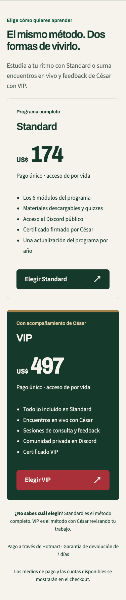</td><td>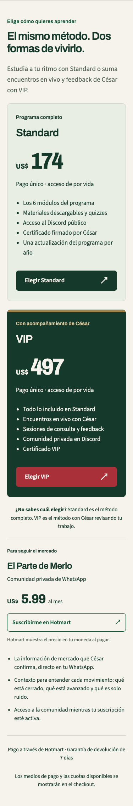</td></tr></table>

### 1280 px

<table><tr><th>Antes</th><th>Después</th></tr><tr><td>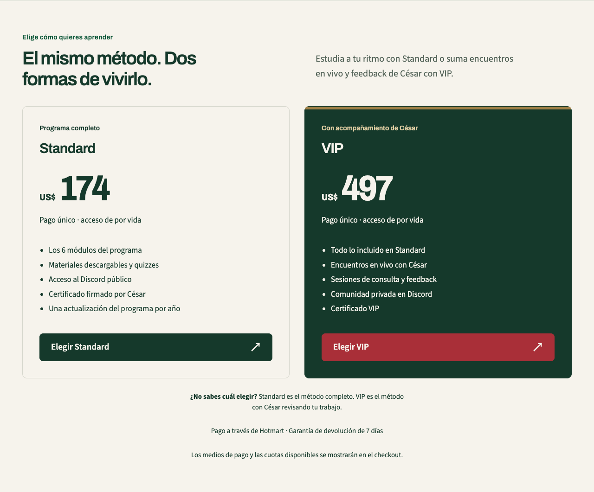</td><td>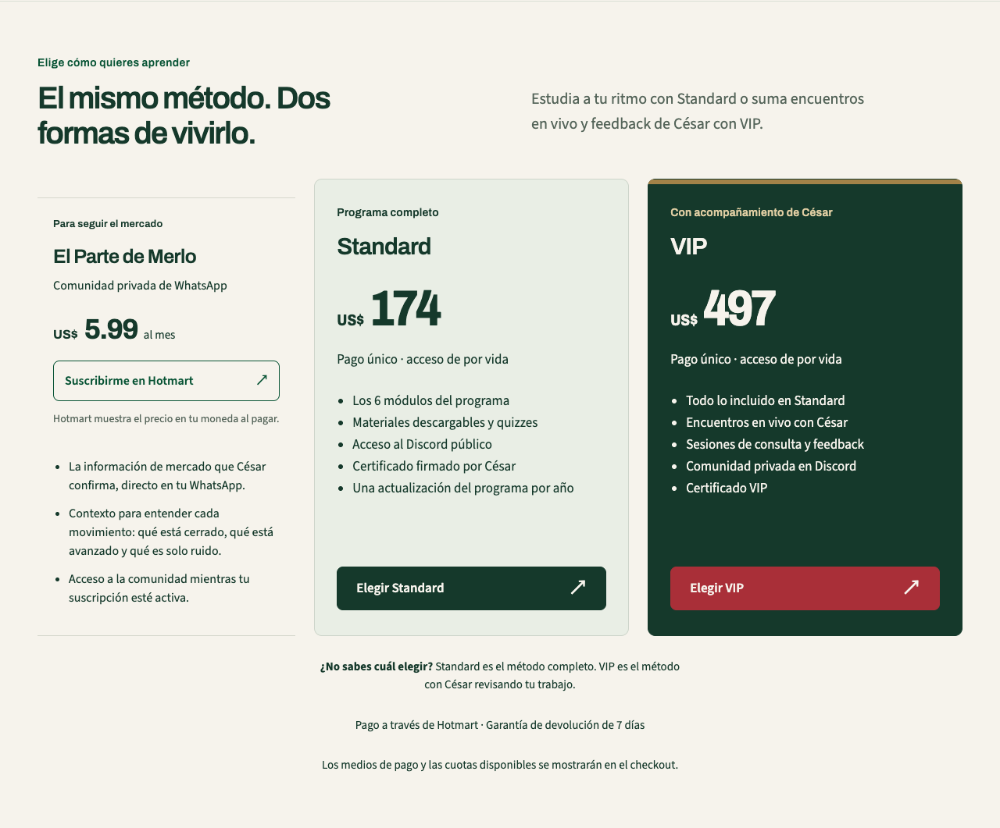</td></tr></table>

Comunidad: 375 y 1280 px

### 375 px

<table><tr><th>Antes</th><th>Después</th></tr><tr><td></td><td></td></tr></table>

### 1280 px

<table><tr><th>Antes</th><th>Después</th></tr><tr><td>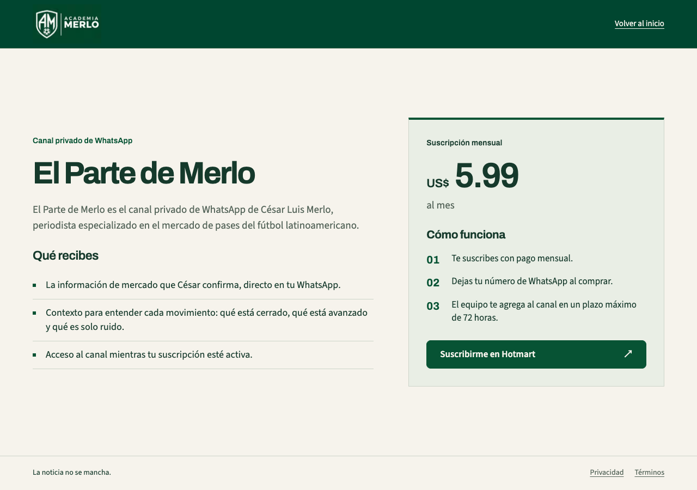</td><td>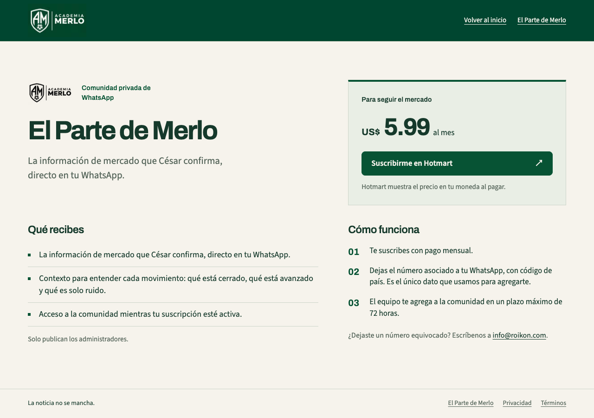</td></tr></table>

Gracias de academia: 375 y 1280 px

### 375 px

<table><tr><th>Antes</th><th>Después</th></tr><tr><td></td><td>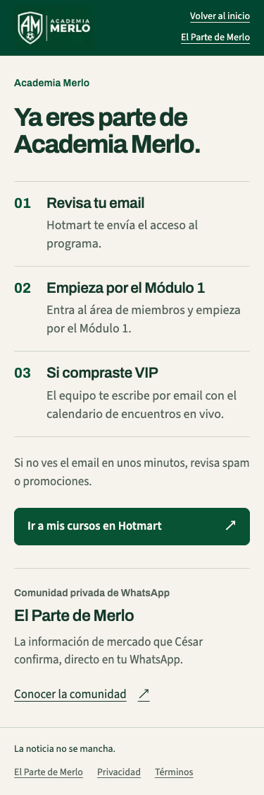</td></tr></table>

### 1280 px

<table><tr><th>Antes</th><th>Después</th></tr><tr><td>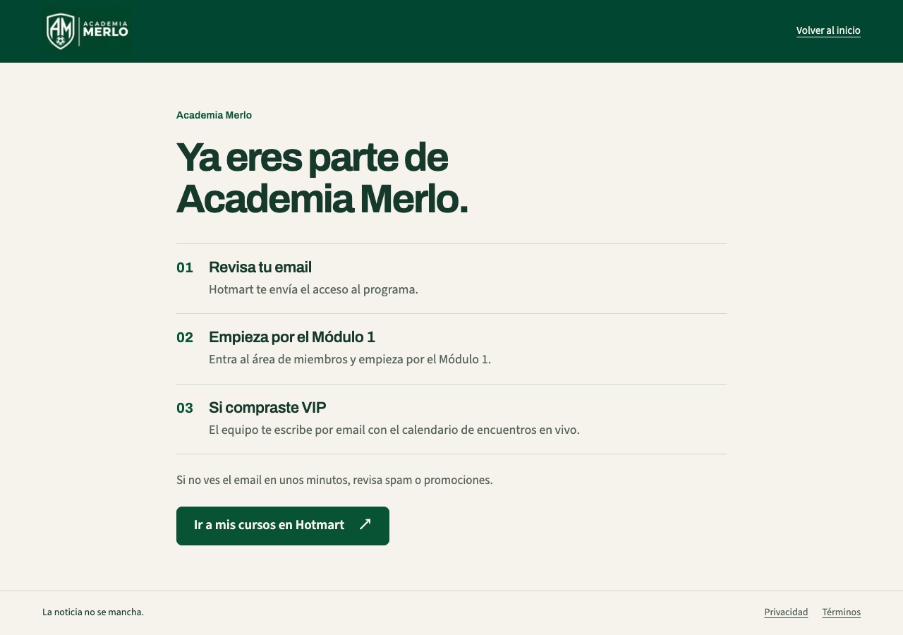</td><td>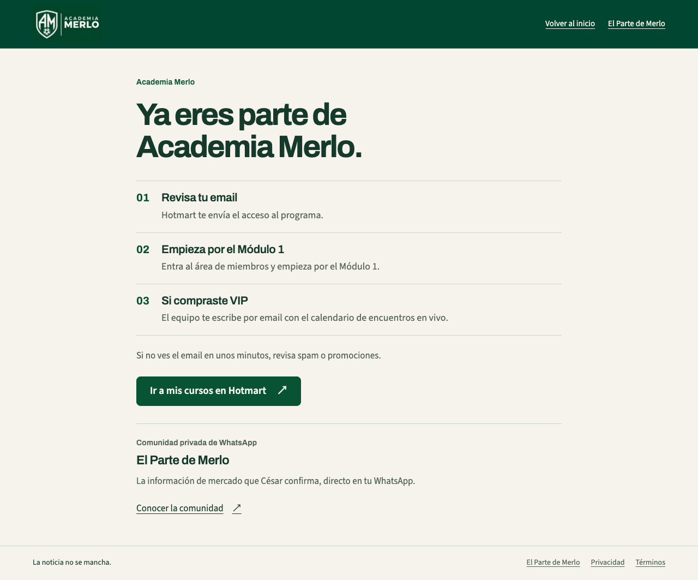</td></tr></table>

Gracias de comunidad: 375 y 1280 px

### 375 px

<table><tr><th>Antes</th><th>Después</th></tr><tr><td>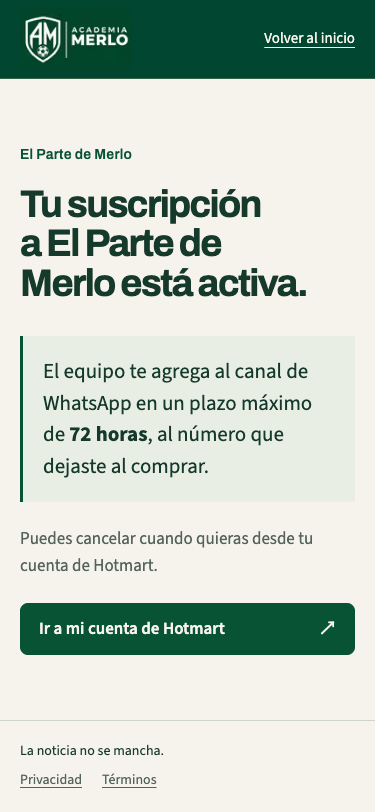</td><td></td></tr></table>

### 1280 px

<table><tr><th>Antes</th><th>Después</th></tr><tr><td>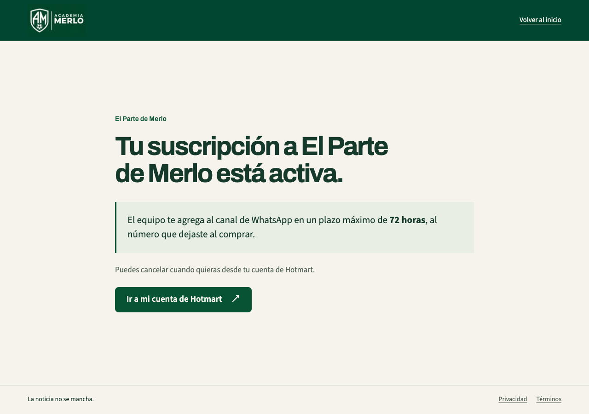</td><td>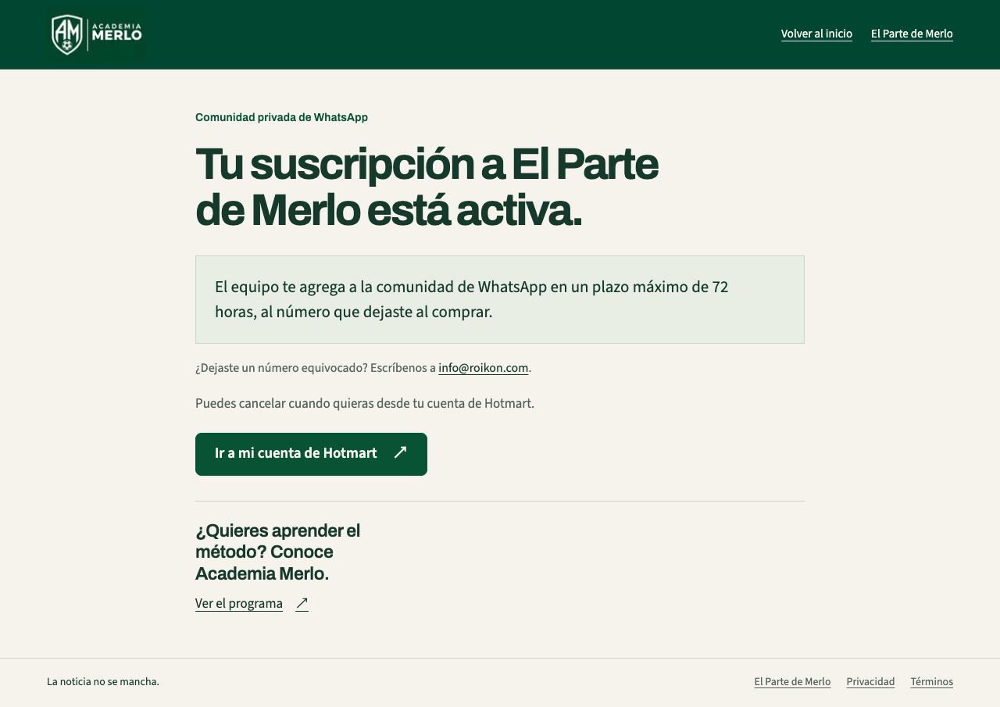</td></tr></table>

